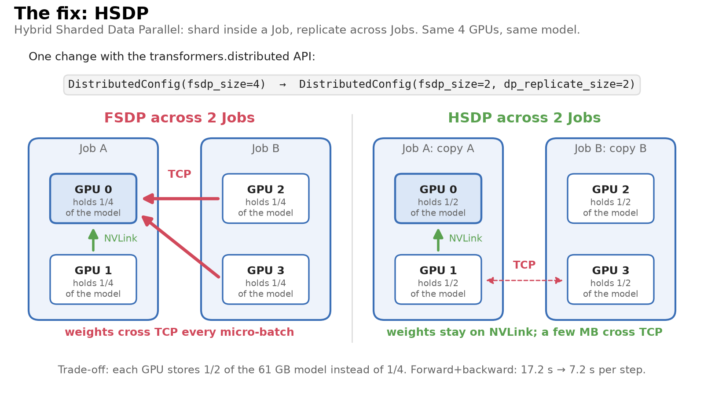

# FSDP vs HSDP on Hugging Face Jobs

Async GRPO + LoRA on Qwen3-30B-A3B with TRL's `AsyncGRPOTrainer`, based on the
[async GRPO + LoRA on HF Jobs](https://huggingface.co/blog/asyncgrpo-lora-hfjobs) recipe. Three vLLM Jobs generate
rollouts, and the trainer runs on 4 H200 GPUs split across two Jobs. All Jobs share a network group.

Splitting the trainer across two Jobs with FSDP is slow. GPUs inside a Job talk over NVLink, but Jobs only talk over
TCP, and FSDP keeps moving the model weights between GPUs. HSDP keeps that traffic inside each Job. With
`transformers.distributed`, it is a one-line change:

```python
DistributedConfig(fsdp_size=4)                       # FSDP
DistributedConfig(fsdp_size=2, dp_replicate_size=2)  # HSDP
```

| layout | trainer | s/step | tokens/s |
|---|---|---:|---:|
| `fsdp` | 2 x h200x2 | 18.17 | 9,705 |
| `hsdp` | 2 x h200x2 | 10.96 | 16,197 |

30 steps per run, measured over steps 9-30. The metrics are in [`results/`](results/).



## Run

```bash
pip install "huggingface_hub==2.4.0"
python launch.py --layout fsdp --isolate
python launch.py --layout hsdp --isolate
python summarize.py runs/*/*/metrics.jsonl
```

`launch.py` uploads the code to a Storage Bucket, starts the vLLM and trainer Jobs, and downloads the metrics at the end.
`--isolate` puts every Job on its own machine, which takes longer to start and costs a bit more. A run uses 7 H200s for
about 15 minutes. `--dry-run` shows the Jobs without launching them.

## Files

- `launch.py`: starts and stops the Jobs
- `train.sh`, `train.py`: the trainer Jobs
- `serve.sh`, `sidecar.py`: the vLLM Jobs
- `gateway.py`: lets the trainer talk to the 3 vLLM replicas as if they were one server
- `summarize.py`: prints the results table
